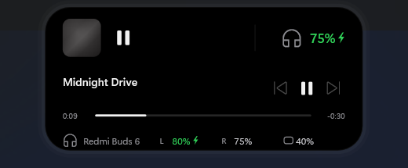

# isle

English | [Русский](README.ru.md)

A tiny Dynamic-Island-style pill for Windows: what's playing, and the battery of your wireless gear, in one small black capsule at the top of the screen.




## Features

- **Media**: cover, title, artist, progress and play / pause / prev / next and seek back / forward 10 s for any app that shows up in the Windows media controls (Spotify, Yandex Music, browsers, Media Player...).
- **Waveform**: six bars next to the play control that move with the sound actually coming out of your speakers, tinted with the cover's colour (grey when there is no cover). Switch it off in the menu.
- **Batteries**: wireless headphones, earbuds (left / right / case), mice, keyboards, Xbox controllers. Percent turns green with a bolt while charging, red at 15% or less.
- **Alerts**: a one-line banner slides out for 3 s when a device connects (with left / right / case levels for earbuds), when a device drops to 15% or 5%, when you plug in or unplug the charger of a laptop, and when the laptop battery falls to 20% or 10%. It reveals the island even when it is hidden, then goes away again. Switch them off with **Notifications** in the menu.
- **Timer and stopwatch**: **Timer** in the menu (1, 5, 10, 15, 25, 60 min) or **Stopwatch** puts a `mm:ss` label at the right end of the pill. When a timer ends, a banner stays (with the system notification sound) until you click it. Click the label while the island is expanded to stop the clock.
- **Privacy dots**: a small orange dot on the cover's corner while an app uses the microphone, a green one for the camera. Expand the island to see which apps.
- **Hover** to expand, **drag** to move it, **right-click** (or the tray icon) for the menu.
- **Auto-hide**: invisible and click-through until the cursor comes near it. Hides while a fullscreen app is in front.
- Spring animations, paced to your display refresh and only while something moves.
- Read-only: it shows devices, it never controls them. Only media is controllable.

## Supported devices

| Source | What you get | Status |
|---|---|---|
| Bluetooth Classic / LE (Windows battery property) | one percent per device, no charging info | works for devices Windows reports a battery for |
| Earbud L / R / case over BLE adverts: Redmi / Xiaomi | left, right, case, charging | decoded from a real Redmi Buds 6 capture and checked live on Redmi Buds 6 (other Xiaomi models untested) |
| Earbud L / R / case: Google Fast Pair | left, right, case, charging | decoded from the spec, checked against third-party adverts |
| Earbud L / R / case: AirPods | left, right, case, charging | community-documented layout, **unverified** |
| Logitech HID++ 2.0 (Unifying / Bolt / Lightspeed receivers, direct) | percent and charging | experimental, read-only queries, untested on hardware |
| Xbox controllers (Xbox Wireless adapter / Bluetooth / USB) | percent and charging via Windows.Gaming.Input; the XInput fallback only has 4 levels | **untested on hardware** (no Xbox controller available) |
| Razer, SteelSeries, HyperX, Corsair dongles | - | not supported |
| Third-party 2.4 GHz dongles that emulate a wired Xbox 360 pad (e.g. 8BitDo Ultimate 2C) | - | not supported: they report no battery to Windows |

No real mouse has been tested yet: Bluetooth mice should work through the Windows battery property; Logitech is untested.

Earbud parts come from a passive Bluetooth scan that listens only for the connected headset's vendor format. It runs continuously while the island is expanded, continuously for the first minute after it appears and then 4 s every 30 s while it stays shown, and once when a headset connects (including at app start). While the island is hidden, nothing is scanned. When both buds are in your ears they stop advertising, so after 30 s of silence the island falls back to the single Windows percent. Charging is only shown where the source reports it (Logitech, Xbox controllers, BLE earbuds).

## Resource use

Measured on Windows 11 at 125% scaling:

- idle CPU: about 0% (0 ms over 20 s, visible or hidden, nothing playing or paused)
- waveform, island visible and music playing: about 1% of one core (a bars-only frame costs about 0.2 ms, drawn at about 30 fps, plus a level read about 10 times a second); a silent track that is "playing": about 0.3% (the level is polled every 150 ms); island hidden while music plays: about 0% (under one 16 ms scheduler tick over 20 s); paused: 0 ms
- waveform, live-battery scanning and the progress timer pause while the display is off or the PC is locked
- private memory: about 11-12 MB
- `isle.exe`: about 0.65 MB
- animation frame: about 1.5-2 ms (render + present); no frames and no timers when nothing moves

## Install

Download `isle.exe` from the Releases page and run it. It is unsigned, so Windows SmartScreen will warn: click **More info**, then **Run anyway**. Tested on Windows 11 only (should work on Windows 10 1809+). Antivirus or anti-cheat software may flag an unsigned app that installs a mouse hook (see Privacy).

## Usage

- Move the cursor near the top-center of the screen to reveal it; hover the pill to expand it.
- Click the cover for next track, the play / pause glyph to toggle.
- In the expanded pill, the circular-arrow **10** buttons jump 10 seconds back / forward, and clicking the progress bar seeks to that point. Seeking works only in players that allow it in the Windows media controls; otherwise the buttons are dimmed.
- Drag to reposition (saved); "Reset position" in the menu puts it back.
- Right-click the pill or the tray icon: **Start with Windows**, **Always visible** (turns auto-hide off), **Show waveform**, **Notifications**, **Timer** (1-60 min, stopwatch, stop), **Size**, **Reset position**, **Exit**. Left-clicking the tray icon shows the island for a few seconds.
- Size: the **Size** submenu offers 75 / 85 / 100 / 115 / 130 %, or hold **Ctrl** and scroll over the pill (5 % per notch, 60-150 %). It applies live and is saved. The default is 85 %.

## Build from source

You need Rust with the `x86_64-pc-windows-gnu` target and MinGW-w64 (for example WinLibs) on `PATH`:

```
rustup default stable-x86_64-pc-windows-gnu
cargo build --release
```

Also run `cargo clippy --release -- -D warnings`, `cargo fmt --check` and `cargo test --release`. Test switches (`ISLE_FAKE_BUDS`, `ISLE_TEST_*`, `ISLE_NOFS`) only work in builds with debug assertions.

## Adding a battery source

A source is one module in `src/battery/` with `fn poll() -> Vec<Device>` (see `bluetooth.rs`). Return an empty list on any error. Call it from the worker in `src/battery/mod.rs`; devices are de-duplicated by `id`. Keep it read-only.

## Privacy

No network access. It reads device batteries, the Windows media session and the output peak level of your default playback device (a single number from the Windows audio meter, used for the waveform; it never records or reads audio), nothing else, and writes nothing to your devices (the Logitech source sends read-only queries; the gamepad source only reads the Windows battery report). Position, size, the always-visible flag, the waveform flag and the notifications flag live in `HKCU\Software\isle`; autostart is the `isle` value under `HKCU\Software\Microsoft\Windows\CurrentVersion\Run`.

To know when the cursor approaches the island, isle installs a global low-level mouse hook (`WH_MOUSE_LL`). It only compares the cursor position with a small rectangle and posts a message when the cursor enters or leaves it; it reads nothing else and logs nothing. The hook is removed while a fullscreen app is in front and when "Always visible" is on.

Matching a Fast Pair or AirPods advert to your headset is heuristic (signal strength plus agreement with the Windows battery level), so a neighbour's earbuds could in rare cases be shown; Xiaomi / Redmi buds are matched exactly by MAC address.

The privacy dots read Windows' own capability-access records for the current user (`HKCU\Software\Microsoft\Windows\CurrentVersion\CapabilityAccessManager\ConsentStore`, the same data behind the microphone / camera indicator in Windows Settings). It only watches that registry key for changes; there are no hooks into other apps, and nothing is recorded or sent anywhere. Laptop power alerts use the standard Windows power notifications and `GetSystemPowerStatus`; on a PC without a battery they stay silent.

## License

MIT, see [LICENSE](LICENSE).
