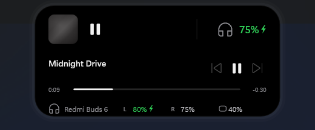

# isle

[English](README.md) | Русский

Маленькая «капсула» в стиле Dynamic Island для Windows: что сейчас играет и сколько заряда у беспроводных устройств. Всё в одной чёрной таблетке в верхней части экрана.




## Возможности

- **Медиа**: обложка, название, исполнитель, прогресс и кнопки воспроизведения / паузы / назад / вперёд и перемотки на 10 с назад / вперёд для любого приложения, которое появляется в медиа-управлении Windows (Spotify, Яндекс Музыка, браузеры, Media Player...).
- **Волна**: шесть полосок рядом с кнопкой воспроизведения. Они двигаются в такт звуку, который реально идёт из колонок, и окрашены в цвет обложки (серые, если обложки нет). Отключается в меню.
- **Батареи**: беспроводные наушники, TWS-наушники (левый / правый / кейс), мыши, клавиатуры, геймпады Xbox. Процент становится зелёным с молнией во время зарядки и красным при 15% и ниже.
- **Наведите** курсор, чтобы раскрыть капсулу, **перетащите**, чтобы переместить, **правый клик** (или значок в трее) открывает меню.
- **Автоскрытие**: капсула невидима и пропускает клики, пока курсор не подойдёт близко. Когда открыто полноэкранное приложение, она прячется.
- Пружинные анимации. Частота подстраивается под обновление дисплея, а кадры рисуются только пока что-то движется.
- Только чтение: капсула показывает устройства, но не управляет ими. Управлять можно только медиа.

## Поддерживаемые устройства

| Источник | Что показывает | Статус |
|---|---|---|
| Bluetooth Classic / LE (свойство батареи в Windows) | один процент на устройство, без данных о зарядке | работает для устройств, у которых Windows сообщает заряд |
| Наушники L / R / кейс по BLE-пакетам: Redmi / Xiaomi | левый, правый, кейс, зарядка | расшифровано по реальному дампу и проверено вживую на Redmi Buds 6 (другие модели Xiaomi не проверялись) |
| Наушники L / R / кейс: Google Fast Pair | левый, правый, кейс, зарядка | расшифровано по спецификации, сверено со сторонними пакетами |
| Наушники L / R / кейс: AirPods | левый, правый, кейс, зарядка | формат описан сообществом, **не проверено** |
| Logitech HID++ 2.0 (ресиверы Unifying / Bolt / Lightspeed, прямое подключение) | процент и зарядка | экспериментально, только запросы на чтение, на железе не тестировалось |
| Геймпады Xbox (адаптер Xbox Wireless / Bluetooth / USB) | процент и зарядка через Windows.Gaming.Input; запасной XInput даёт всего 4 уровня | **не проверено на железе** (геймпада Xbox не было) |
| Донглы Razer, SteelSeries, HyperX, Corsair | - | не поддерживаются |
| Сторонние 2,4 ГГц донглы, которые эмулируют проводной геймпад Xbox 360 (например, 8BitDo Ultimate 2C) | - | не поддерживаются: они не передают Windows заряд |

Настоящую мышь пока никто не проверял. Bluetooth-мыши должны работать через свойство батареи Windows, а Logitech не тестировалась.

Заряд левого, правого и кейса приходит из пассивного приёма Bluetooth-пакетов: слушается только формат производителя подключённых наушников. Пока капсула раскрыта, приём идёт непрерывно. Когда она просто видна, первую минуту тоже непрерывно, дальше по 4 с каждые 30 с. Ещё один короткий приём запускается при подключении наушников, в том числе при старте приложения. Пока капсула скрыта, ничего не сканируется. Когда оба наушника в ушах, они перестают вещать, и через 30 с тишины капсула показывает общий процент из Windows. Зарядка показывается только там, где источник её сообщает (Logitech, геймпады Xbox, BLE-наушники).

## Нагрузка

Замеры на Windows 11 при масштабе 125%:

- CPU в простое: около 0% (0 мс за 20 с, видимая или скрытая капсула, ничего не играет или пауза)
- волна, капсула видна и играет музыка: около 1% одного ядра (кадр с одними полосками занимает около 0,2 мс, рисуется примерно 30 раз в секунду, плюс чтение уровня около 10 раз в секунду); трек «играет», но тишина: около 0,3% (уровень опрашивается каждые 150 мс); капсула скрыта, музыка играет: около 0% (меньше одного тика планировщика в 16 мс за 20 с); пауза: 0 мс
- волна, приём пакетов наушников и таймер прогресса приостанавливаются, пока экран выключен или ПК заблокирован
- приватная память: около 11-12 МБ
- `isle.exe`: около 0,65 МБ
- кадр анимации: около 1,5-2 мс (отрисовка + показ); если ничего не движется, нет ни кадров, ни таймеров

## Установка

Скачайте `isle.exe` на странице Releases и запустите. Файл не подписан, поэтому SmartScreen предупредит: нажмите **Подробнее**, затем **Выполнить в любом случае**. Проверено только на Windows 11 (на Windows 10 1809+ должно работать). Антивирус или античит могут ругаться на неподписанное приложение с хуком мыши (см. «Приватность»).

## Использование

- Подведите курсор к верхнему центру экрана, чтобы капсула появилась. Наведите на неё, чтобы раскрыть.
- Клик по обложке включает следующий трек, клик по значку play / пауза переключает воспроизведение.
- В раскрытой капсуле кнопки со стрелкой и цифрой **10** перематывают на 10 секунд назад / вперёд, а клик по полосе прогресса переходит в эту точку. Перемотка работает только в плеерах, которые разрешают её в медиа-управлении Windows; в остальных кнопки затемнены.
- Перетащите, чтобы переместить (положение сохраняется). Пункт «Сбросить позицию» в меню возвращает капсулу на место.
- Правый клик по капсуле или значку в трее открывает меню: **Запускать вместе с Windows**, **Всегда показывать** (отключает автоскрытие), **Показывать волну**, **Сбросить позицию**, **Выход**. Левый клик по значку в трее показывает капсулу на несколько секунд.

## Сборка из исходников

Нужны Rust с таргетом `x86_64-pc-windows-gnu` и MinGW-w64 (например, WinLibs) в `PATH`:

```
rustup default stable-x86_64-pc-windows-gnu
cargo build --release
```

Дополнительно запустите `cargo clippy --release -- -D warnings`, `cargo fmt --check` и `cargo test --release`. Тестовые переключатели (`ISLE_FAKE_BUDS`, `ISLE_TEST_*`, `ISLE_NOFS`) работают только в сборках с debug assertions.

## Как добавить источник батареи

Источник — это один модуль в `src/battery/` с функцией `fn poll() -> Vec<Device>` (пример: `bluetooth.rs`). При любой ошибке возвращайте пустой список. Вызовите его из воркера в `src/battery/mod.rs`; устройства дедуплицируются по `id`. Источник должен быть только на чтение.

## Приватность

Сети нет. Приложение читает заряд устройств, медиа-сессию Windows и пиковый уровень выхода вашего устройства воспроизведения по умолчанию (одно число из аудиометра Windows для волны; звук оно не записывает и не читает), больше ничего. На устройства ничего не пишется (источник Logitech шлёт только запросы на чтение; источник геймпадов читает только отчёт о батарее Windows). Положение, флаг «всегда показывать» и флаг волны лежат в `HKCU\Software\isle`; автозапуск — это значение `isle` в `HKCU\Software\Microsoft\Windows\CurrentVersion\Run`.

Чтобы понять, что курсор приближается к капсуле, isle ставит глобальный низкоуровневый хук мыши (`WH_MOUSE_LL`). Он только сравнивает позицию курсора с небольшим прямоугольником и отправляет сообщение, когда курсор входит в него или выходит. Больше он ничего не читает и ничего не логирует. Хук снимается, пока открыто полноэкранное приложение, и пока включено «Всегда показывать».

Сопоставление пакетов Fast Pair или AirPods с вашими наушниками эвристическое (уровень сигнала плюс совпадение с уровнем батареи из Windows), поэтому в редких случаях может показаться чужое устройство соседа. Наушники Xiaomi / Redmi сопоставляются точно, по MAC-адресу.

## Лицензия

MIT, см. [LICENSE](LICENSE).
